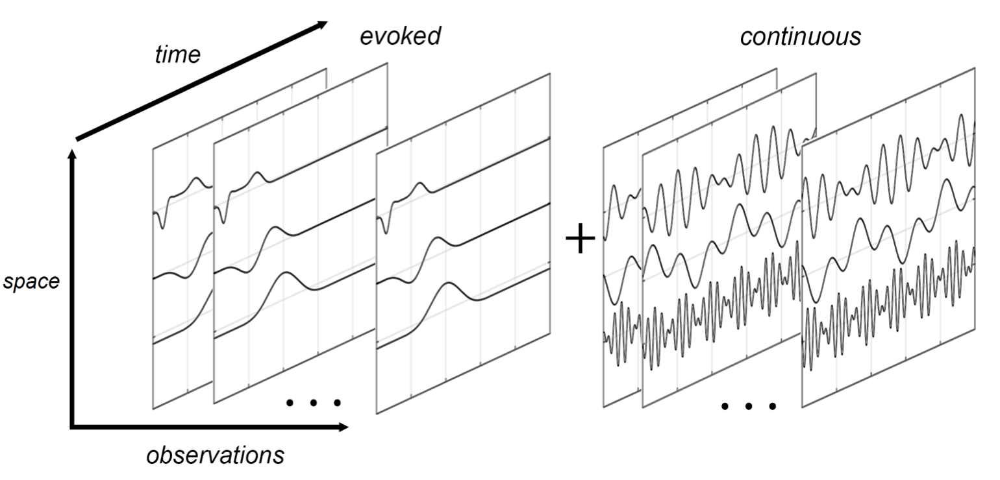
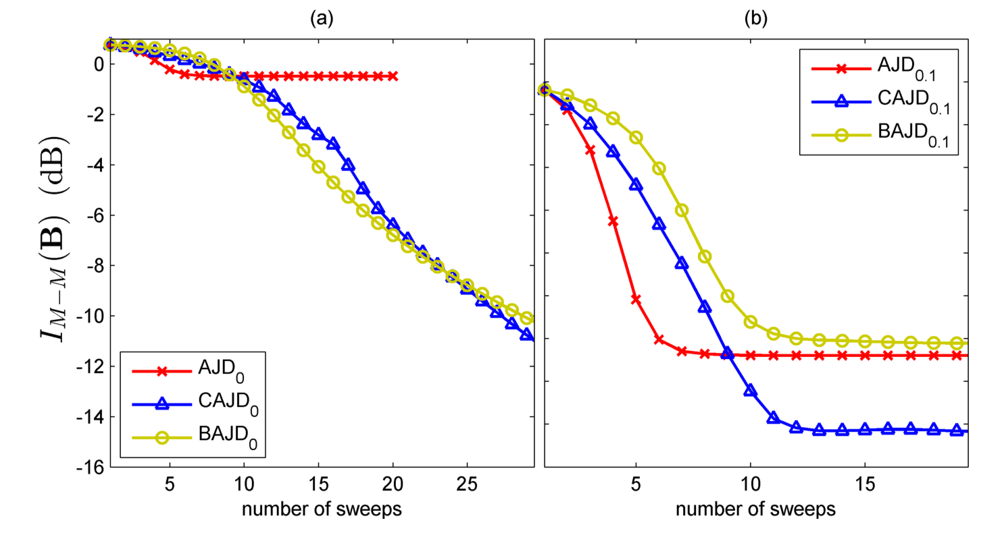

# Tutorial — Composite Approximate Joint Diagonalization (MATLAB)

This tutorial walks through [`script_CAJD_tuto.m`](script_CAJD_tuto.m) step by step. It then explains how the paper applied the same functions to real EEG. The figures come from the paper (Korczowski et al., EUSIPCO 2016, [hal-01357245](https://hal.science/hal-01357245v1)), so you can see the expected results without running MATLAB.

> The code was written for MATLAB R2015a. The snippets in Part 2 follow the paper's procedure but were **not** executed for this tutorial. Treat them as a template.

---

## 0. The idea in one picture



*Paper Fig. 1. Each EEG trial is the sum of **evoked** sources and **continuous** sources. Evoked sources have a fixed spatial pattern **and** a fixed time course; continuous sources only have a fixed spatial pattern. Both reach the electrodes through the same spatial mixing matrix `A`.*

| | Evoked part (ERP) | Continuous part (ongoing EEG) |
|---|---|---|
| Model | `X_k = A S_k Eᵀ` (bilinear) | `R_l = A Λ_l Aᵀ` (linear, second-order statistics) |
| What changes across observations | only the amplitude `S_k` (diagonal) | only the source power `Λ_l` (diagonal) |
| Natural data to diagonalize | trials or ensemble averages `X_k` | covariances, co-spectra `R_l` |
| Method using only this part | **BAJD**, finds `B` and `D` | **AJD**, finds `B` only |

**CAJD** diagonalizes both sets at once with the same spatial unmixing `B`:

```
minimize  Σ_k ‖off(Bᵀ X_k D)‖²  +  Σ_l ‖off(Bᵀ R_l B)‖²
```

---

## Part 1 — Simulation tutorial (`script_CAJD_tuto.m`)

### Step 1: parameters

```matlab
nTest = 1;              % number of independent simulations (paper: 100)
N     = 8;              % number of sensors = number of sources   (paper: 16)
T     = 128;            % samples per trial
K     = 100;            % number of bilinear observations X_k
F     = 20;             % number of symmetric matrices C_f        (paper: L = 100)
condA = 1;              % 1 = orthogonal A                        (paper: cond(A) in [1,20))
allCondE = {[50 100]};  % condition number range of E: strongly non-orthogonal
allSNR   = {inf, 20};   % noiseless, then noisy
```

The default parameters run in a few seconds. To get closer to the paper, set `nTest = 100`, `N = 16`, `F = 100` and `condA = [1 20]`.

> On macOS/Linux, first replace `outputDIR = '.\figures\'` with `outputDIR = fullfile('.', 'figures', filesep);`.

### Step 2: simulate data, `simBAJD_dat`

```matlab
opSim = struct('N',N,'T',T,'K',K,'F',F,'condA',condA,'condE',condE,'SNR',SNR);
[X, Cf, A, E] = simBAJD_dat(opSim);
```

- `X` (N×T×K): trials `X_k = A S_k Eᵀ + noise`, with random diagonal amplitudes `S_k`.
- `Cf` (N×N×F): symmetric matrices `C_f = A Λ_f Aᵀ + noise` built with the **same** `A`. They stand in for co-spectra of the ongoing EEG.
- `A`, `E`: the true mixing matrices. They are kept only to score the result.

### Step 3: build the AJD target set, `convertDat_BAJD`

Plain AJD cannot use rectangular trials, so the trials are turned into covariances:

```matlab
[C, Ct] = convertDat_BAJD(X, Cf);   % C = [Cf (rescaled), cov(X_k)]
```

`Ct(:,:,k) = cov(X_kᵀ)` corresponds to the paper's `X_k X_kᵀ`. `Cf` is rescaled so that both groups have the same total trace and therefore weigh the same in AJD.

### Step 4: initialization from the average trial

```matlab
[U, S, V] = svd(mean(X,3)', 0);   % X̄ᵀ = U Λ Vᵀ   (paper eq. 9)
V  = V(:, 1:N);
B0 = inv(V)';                     % spatial init (V is orthogonal, so B0 = V)
D0 = pinv(U)';                    % temporal init: the N leading temporal singular vectors
```

Jacobi-like algorithms are sensitive to their starting point. The SVD of the ensemble average already separates the evoked activity reasonably well (paper Section II-D).

### Step 5: run the three solvers from the same starting point

```matlab
epsilon = 1e-18;  itMax = 50;
[B_CAJD, D_CAJD, S_CAJD, C_CAJD, info_CAJD] = gp_CAJD_GPT(X, Cf, ...
        struct('B0',B0,'D0',D0,'eps',epsilon,'itMax',itMax,'A',A,'E',E));
[B_AJD,  C_AJD,  info_AJD]  = gp_AJD_GPT(C, ...
        struct('B0',B0,'eps',epsilon,'itMax',itMax,'A',A));
[B_BAJD, D_BAJD, S_BAJD, info_BAJD] = gp_BAJD_GPT(X, ...
        struct('B0',B0,'D0',D0,'eps',epsilon,'itMax',itMax,'A',A,'E',E));
```

All three use the same Gauss Planar Transformation sweeps, so differences come from the **model**, not the optimizer. `eps = 1e-18` effectively turns the stopping rule off, so every method runs `itMax` sweeps. That makes the convergence curves comparable.

> Pass `A` (and `E`) even though they are only used for scoring: the current `gp_critMoAm` errors when they are empty. See *Known issues* in the README.

### Step 6: score the separation with the Moreau-Macchi index

At every sweep, `info(it).critA = gp_critMoAm(A, B)` measures how far `BᵀA` is from a scaled permutation matrix:

```
I_MM(H) = 1/(2N(N−1)) · [ Σ_i ( Σ_j |H_ij| / max_j |H_ij| − 1 ) + Σ_j ( Σ_i |H_ij| / max_i |H_ij| − 1 ) ],   H = BᵀA
```

The index is **0 for perfect separation** and close to 1 for random `B`. `info(it).critE` gives the same index for the temporal side, with `H = DᵀE`.

### Step 7: what you should get

The script saves `figures/CAJD_sim.mat`, `figures/MoMaA.png` (the index on `B`) and `figures/MoMaE.png` (the index on `D`). Here is the paper's version of `MoMaA`, averaged over 100 simulations:



*Paper Fig. 2: Moreau-Macchi index on `B` vs. number of sweeps. (a) No noise. (b) Noise σ = 0.1. The y-axis shows `log10` of the index (the script plots `log10`, although the label says dB).*

How to read it:

1. **AJD stalls (a).** When `E` is far from orthogonal, `X_k X_kᵀ = A S_k EᵀE S_k Aᵀ` is no longer diagonalizable by `A`. Turning trials into covariances throws away the bilinear structure, and AJD converges to a wrong `B`.
2. **BAJD and CAJD both reach the true solution without noise (a).** They stay close all the way, and the bilinear model is exact here.
3. **With noise, CAJD separates best (b).** It reaches about 10⁻¹⁴·⁵ against about 10⁻¹¹ for BAJD and about 10⁻¹¹·⁵ for AJD. The symmetric matrices `C_f` add *diversity* that makes the estimate of `B` more robust. For `D` (the `MoMaE` figure), CAJD and BAJD perform about the same, since only the bilinear part constrains `D`.

---

## Part 2 — Applying CAJD to EEG (paper Section III-B, P300 data)

The paper used two-player Brain Invaders P300 recordings (32 electrodes, 512 Hz). The data are not in this repository, but a similar public dataset, **bi2015a**, is available through [MOABB](https://moabb.neurotechx.com/docs/generated/moabb.datasets.BI2015a.html). The pipeline was:

1. **Preprocess.** Keep 16 electrodes, band-pass 1–20 Hz (4th-order Butterworth, forward-backward), downsample to 128 Hz, then cut 1 s epochs from each flash (T = 128). Label each epoch TARGET or NON-TARGET.
2. **Bilinear set `X`: bootstrapped ensemble averages.** Draw 40 averages of 50 TARGET epochs and 10 averages of 50 NON-TARGET epochs. Averaging boosts the evoked part relative to the ongoing EEG, so these 50 matrices follow the bilinear model much better than single trials do.
3. **Linear set `C`: co-spectra.** Compute Bartlett-averaged co-spectral matrices over all epochs for f = 1, 1.5, …, 20 Hz, which gives 39 matrices.
4. **Initialize.** Use the SVD of the average evoked response, as in Step 4. The paper used the regression-based average of Congedo et al. 2016.
5. **Run CAJD**: `[B, D, S, C] = gp_CAJD_GPT(Xbar, Cf, opt)`.
6. **Interpret.**
   - `Â = inv(B)`: each column is the scalp map of one source.
   - `Ê = pinv(D)`: each row is the time course of one source.
   - Single-trial back-projection of source *i* (paper eq. 13): `X̂_{k,i} = Â(:,i) · Ŝ_k(i,i) · Ê(i,:)` with `Ŝ_k = Bᵀ X_k D`.


*Paper Fig. 3: the 16 sources found by CAJD. c06 has the P3b scalp map and latency (~300 ms, parietal). c11 is the early visual complex (occipital).*


*Back-projected P3b at AFz, Cz and Pz: raw trials vs. CAJD, BAJD and AJD. Grey band: 10–90 % quantiles across trials. CAJD recovers the P3b with the correct shape and less trial-to-trial variability, especially before 250 ms and after 700 ms.*

A template for steps 2–3 (untested):

```matlab
% epochs: N x T x nTrials, labels: 1 = TARGET, 0 = NON-TARGET
ta = find(labels==1);  nt = find(labels==0);
Xbar = zeros(N, T, 50);
for z = 1:40, Xbar(:,:,z)    = mean(epochs(:,:,ta(randi(numel(ta),1,50))), 3); end
for z = 1:10, Xbar(:,:,40+z) = mean(epochs(:,:,nt(randi(numel(nt),1,50))), 3); end
```

For the co-spectra `Cf`, take the FFT of each epoch (zero-padded to 2·fs points for 0.5 Hz resolution). At each frequency f, average the cross-spectral matrices `Z(:,f) Z(:,f)ᴴ` over all epochs (Bartlett's method), then keep the **real part** so the matrix is symmetric.

---

## Going further

- **Python port:** a from-scratch Python reimplementation with scikit-learn / MNE / MOABB compatible APIs is in preparation.
- **Questions:** open an issue on this repository.
